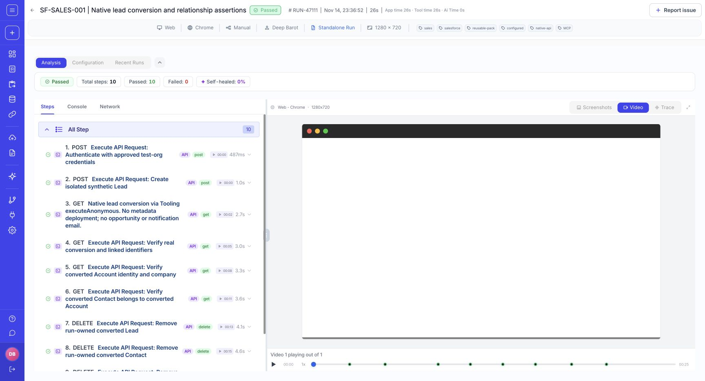
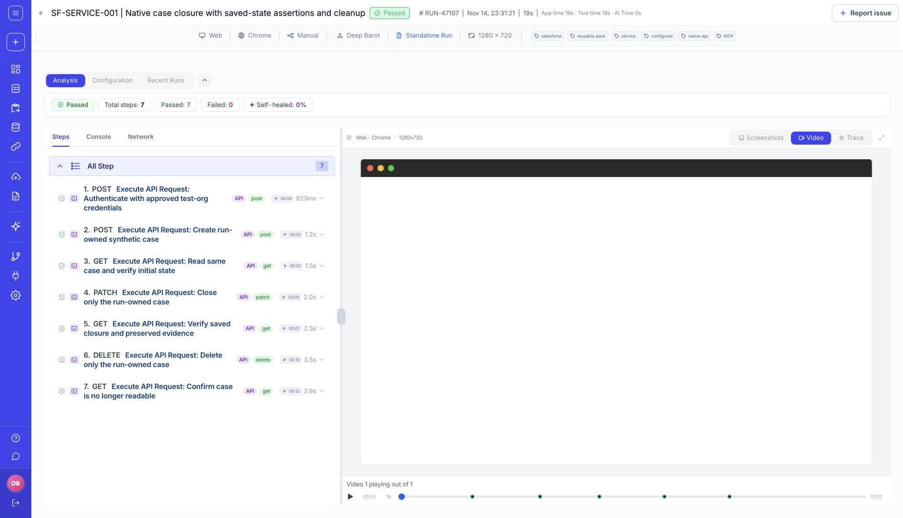
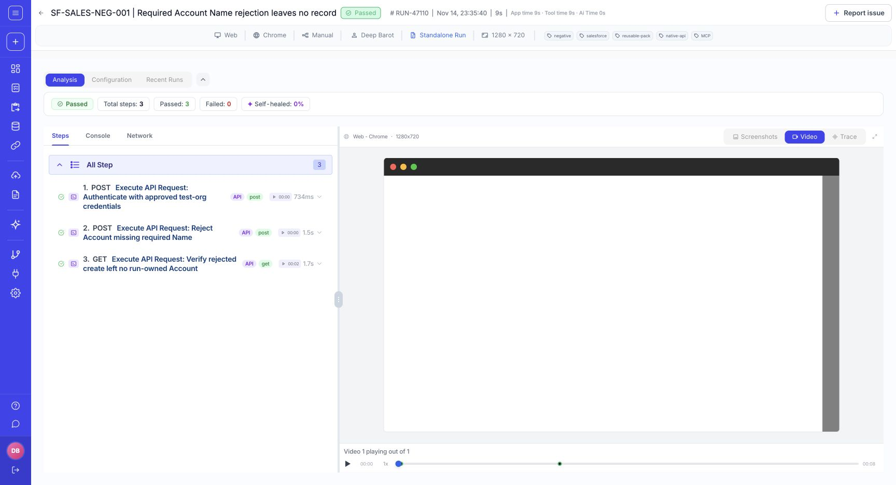

# Native Salesforce API companion

The optional `npm run test:native` command executes three real Salesforce API journeys. It is separate from the twelve synthetic browser scenarios. The companion uses Node HTTP requests in both repositories; it does not establish Playwright or Selenium Lightning UI coverage.

## Verified reference scope

On November 15, 2026 UTC, both copies passed against one explicitly approved non-production Developer Edition. Each run created four synthetic records, verified their relationships/business fields, deleted them, and confirmed they were no longer readable. This is one customized reference org, not a greenfield/brownfield benchmark or all-module certification.

1. **Sales:** create a Lead, use `Database.convertLead`, assert `IsConverted`, read the linked Account and Contact, and verify the Contact belongs to that Account. Opportunity creation and notification email are disabled.
2. **Service:** create a Case with configured resolution evidence, close it, then assert `IsClosed`, exact status, record identity, evidence and unchanged ownership.
3. **Negative:** submit an Account without its required Name, assert `REQUIRED_FIELD_MISSING`, then query the run-specific marker to establish no record was created.

The conversion uses Tooling API `executeAnonymous` with a small scoped Apex call. This performs record operations and needs existing API/Apex permissions; it does not deploy a class or change metadata. Do not grant permissions merely to make the example run.

## Configure and run

Supply these through your existing local secret manager or process environment. Never commit their values:

| Variable | Meaning |
| --- | --- |
| `SF_INSTANCE_URL` | Reviewed HTTPS Salesforce My Domain origin |
| `SF_CLIENT_ID`, `SF_CLIENT_SECRET` | Approved client-credentials application |
| `SF_EXPECTED_ORG_ID` | Exact expected Organization ID |
| `SF_APPROVED_TEST_ORG_ID` | Same ID, explicitly approved for these test writes |
| `SF_API_VERSION` | Reviewed API version, such as `68.0` for the reference run |
| `SF_CONVERTED_STATUS` | Valid converted Lead status in this org |
| `SF_RESOLUTION_FIELD` | Actual Case resolution/evidence field API name |
| `SF_CLOSED_STATUS` | Actual closed Case status |

```sh
npm ci
npm run test:native
```

Review active automations and downstream effects before running. A Developer Edition is not automatically a sandbox. The runner checks exact org identity before writes and uses a fresh UUID marker for each run. Existing records are not intended test targets. No automatic retry is performed. The private receipt is `artifacts/native-result.json`, excluded from Git; preserve it for troubleshooting. A lost response can leave an uncertain write, so reconcile the run marker before retrying. Cleanup is recoverable Salesforce deletion, not recycle-bin purging.

## What this does not prove

Restricted-user behavior, field-level security, sharing, active Flow branches, missing-resolution enforcement, UI usability, mobile, load, downstream integrations, CPQ, Revenue Cloud, industry products and clean-org portability require separate assets and evidence. The reference org's case root-cause gate was inactive and its local FNOL Flow was draft; successful case closure cannot prove either control.

## Maintain the asset

Record rule owner/version, org/product/persona mappings, configuration date, code revision, assertion results and cleanup. Preserve failures. Inspect every change to selectors or expected values. Promote a characterization test into acceptance only after the process owner confirms intended behavior.

Sources: [Salesforce Lead conversion](https://developer.salesforce.com/docs/platform/api/guide/sforce-api-calls-convertlead.html), [Lead object fields](https://developer.salesforce.com/docs/platform/object-reference/references/standard-objects/object-lead.html), [Tooling API](https://resources.docs.salesforce.com/latest/latest/en-us/sfdc/pdf/api_tooling.pdf).

## ContextQA execution evidence

These screenshots show the separately authored ContextQA API cases against the same reference org. The Node companion was run separately. The result viewer labels its runner Web/Chrome, but these steps perform API requests; the blank video canvas is not a Lightning UI walkthrough. Dates in the screenshots are local; the runs occurred November 15 UTC.






